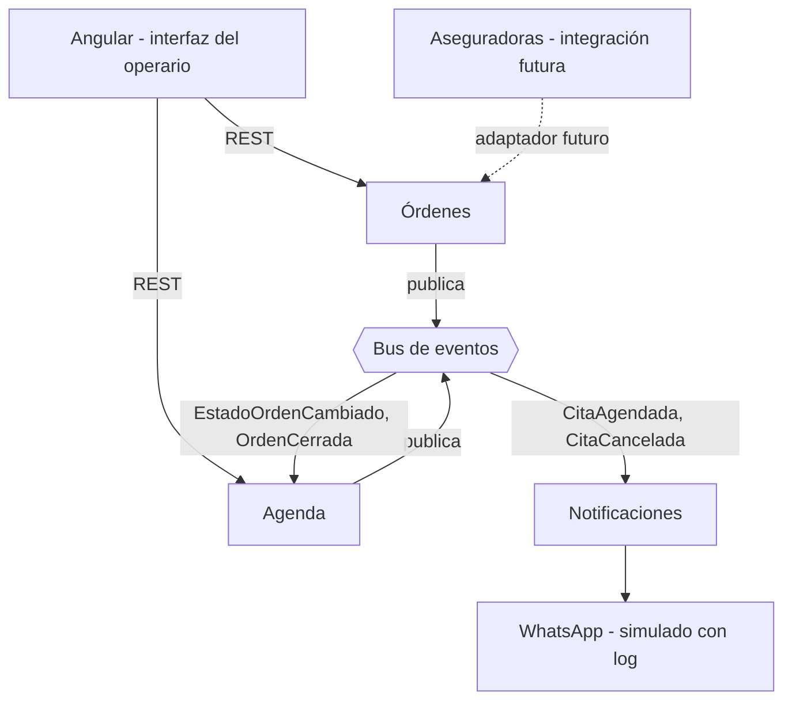

# DECISIONES

Sistema para un taller automotriz que atiende vehículos de particulares y de aseguradoras. Este documento explica las fronteras que tracé, las alternativas que descarté y lo que dejé fuera.

> Los puntos marcados con `TODO` deben completarse con lo que realmente se implemente.

---

## 1. Principio rector

Cada dato tiene un solo dueño y solo el dueño lo modifica. Los demás servicios piden el cambio al dueño o guardan una copia de solo lectura, actualizada por eventos. Ningún servicio escribe en la base de datos de otro.

## 2. Diagrama de contexto



## 3. Fronteras

### 3.1 Órdenes

- **Es dueño de:** clientes, vehículos, órdenes, estado, transiciones y el registro de auditoría.
- **Responsabilidad:** es la única que cambia el estado de una orden. Valida las transiciones (por ejemplo, reabrir exige una razón), guarda el cambio y su registro de auditoría en la misma transacción, y publica el evento correspondiente.
- **Por qué aquí:** las transiciones ocurren en Órdenes, así que la auditoría vive donde ocurre el cambio y no hay forma de cambiar un estado sin dejar registro.

### 3.2 Agenda

- **Es dueño de:** operarios, franjas, cupos y citas.
- **Responsabilidad:** agenda y cancela citas respetando el cupo por operario y franja. Guarda una copia de solo lectura del estado de la orden, actualizada por eventos, y la referencia a la orden es un `ordenId` sin llave foránea (son bases de datos distintas).
- **No escribe el estado de la orden.** Si necesita cerrar una orden, lo pide a Órdenes.
- **Por qué separada:** el cupo por franja exige consistencia inmediata y control de concurrencia, un problema propio que no tiene que ver con el ciclo de vida de la orden.

### 3.3 Notificaciones

- **Es dueño de:** las plantillas, la política de a quién avisar y el registro de mensajes enviados.
- **Responsabilidad:** consume eventos y envía el aviso por WhatsApp (simulado con un log).
- **Por qué separada:**
  - Aísla fallos: si el canal de mensajería cae, las órdenes y las citas siguen funcionando.
  - El canal cambia por razones distintas a las del negocio de órdenes (hoy WhatsApp, mañana otro).
  - Es transversal: participa en varios momentos del flujo sin que ningún otro servicio tenga que conocer los detalles del envío.
  - Hoy los avisos se hacen a mano por WhatsApp, así que automatizarlos resuelve un problema real del cliente.

## 4. Comunicación

- **REST** solo entre el front y los servicios, donde el usuario espera respuesta inmediata.
- **Eventos** entre servicios. Así, un fallo en Notificaciones nunca bloquea agendar una cita ni cerrar una orden.
- `TODO`: indica el broker usado y si implementaste outbox transaccional (que el cambio y el evento se guarden en la misma transacción) o lo dejaste como mejora.

| Evento | Emisor | Consumidores | Efecto |
|---|---|---|---|
| `EstadoOrdenCambiado` (de, a, razón, operario, momento) | Órdenes | Agenda | Actualiza su copia del estado |
| `OrdenCerrada` | Órdenes | Agenda | Cancela las citas pendientes con motivo `CIERRE_ORDEN` |
| `CitaAgendada` | Agenda | Notificaciones | Avisa al cliente |
| `CitaCancelada` (motivo) | Agenda | Notificaciones | Avisa, salvo si el motivo es `CIERRE_ORDEN` |

## 5. Decisiones sobre las reglas del enunciado

### 5.1 El cierre cancela citas y no avisa al cliente

Agenda emite `CitaCancelada` con un motivo. La política de a quién avisar vive en Notificaciones, que no envía mensaje cuando el motivo es `CIERRE_ORDEN`. Así Agenda no tiene que conocer nada del canal de mensajes.

Alternativa descartada: un campo `notificar=false` en el evento. Funciona, pero hace que Agenda decida algo que no le corresponde y obliga a cambiarla cuando cambie la política de avisos.

### 5.2 Cupo por operario y franja

El cupo se reserva con una operación atómica en la base de datos, no con "consultar y luego insertar", para evitar que dos agendamientos simultáneos superen el límite:

```sql
UPDATE franja_cupo SET ocupados = ocupados + 1
WHERE operario_id = :o AND inicio = :f AND ocupados < cupo_max;
-- 0 filas afectadas = franja llena
```

Al cancelar una cita se libera el cupo en la misma transacción.

`TODO`: agrega una prueba que lance agendamientos en paralelo y demuestre que no se supera el límite.

### 5.3 Estados y reapertura

Órdenes aplica una máquina de estados: una transición inválida se rechaza. Reabrir exige una razón, que forma parte de la transición y queda en la auditoría.

`TODO`: lista los estados y transiciones reales que implementes.

### 5.4 Auditoría que nadie pueda alterar

- La tabla de auditoría es de solo inserción: el usuario de base de datos de la aplicación tiene permiso únicamente de `INSERT` sobre ella y un trigger bloquea `UPDATE` y `DELETE`.
- Cada registro guarda quién cambió el estado, cuándo, de qué estado a cuál y la razón.
- **Límite reconocido:** un administrador de la base de datos podría manipularla. `TODO`: indica si añadiste hash encadenado entre registros para detectarlo.

### 5.5 Órdenes de aseguradoras por integración

La orden tiene `origen` (`OPERARIO` o `ASEGURADORA`) e `id_externo` opcional, y no exige un operario creador. No se construye el conector hoy. Cuando llegue, será un adaptador separado que traduzca el formato de cada aseguradora al comando de crear orden, sin tocar el modelo interno.

## 6. Alternativas descartadas

**Auditoría como servicio aparte.** Añadiría complejidad y latencia innecesarias. Como Órdenes es dueña del estado y de sus transiciones, el registro vive en el mismo servicio y se guarda en la misma transacción. Lo que cedo: la separación de permisos que daría un servicio independiente; la compenso con el usuario de base de datos de solo inserción y el trigger.

**Servicio de usuarios compartido (operarios y clientes).** Descartado porque tienen datos distintos y, en el caso de los operarios, necesito consistencia y atomicidad en los cupos por franja. Cada grupo vive con el servicio que lo necesita: clientes en Órdenes, operarios en Agenda.

**Dejar Notificaciones fuera de alcance.** Lo consideré, pero hoy todos los avisos se hacen a mano por WhatsApp y automatizarlos es el problema central del cliente.

**Que Agenda escriba directamente el estado de la orden.** Rompería la propiedad del dato y saltaría las reglas de transición y la auditoría. Agenda solo mantiene una copia de solo lectura.

`TODO`: añade otras alternativas que realmente hayas evaluado (por ejemplo, un monolito o llamadas directas a Notificaciones).

## 7. Propuestas de la IA que rechacé

1. **Auditoría como servicio aparte con base propia.** La IA lo propuso por la separación de permisos. Lo rechacé porque agrega complejidad y latencia sin necesidad: Órdenes ya es dueña de las transiciones y el registro se guarda en la misma transacción. Acepté la pérdida de separación y la mitigué con permisos de solo inserción.
2. `TODO`: añade una segunda propuesta real, con su motivo, solo si surgió durante el trabajo.

## 8. Qué dejé fuera y por qué

| Fuera de alcance | Motivo |
|---|---|
| Autenticación real | Se simula la identidad del operario; basta para saber quién cambia cada estado |
| Envío real de WhatsApp | El enunciado permite simularlo con un log |
| Conector de aseguradoras | Solo se deja la costura (5.5) |
| Vistas diferenciadas por rol | Hay un solo perfil de operario; los permisos por rol no son el centro de la prueba |
| `TODO` otros | Indica qué más dejaste fuera |

## 9. Riesgos conocidos

- La copia del estado de la orden en Agenda puede quedar desactualizada unos instantes. Si se agenda una cita justo antes de cerrar la orden, el evento de cierre la cancelará de todos modos.
- `TODO`: añade los riesgos que descubras al implementar.

## 10. Cómo ejecutarlo

```bash
docker compose up --build
```

`TODO`: documenta puertos, usuarios de prueba y dónde ver el log de WhatsApp.
