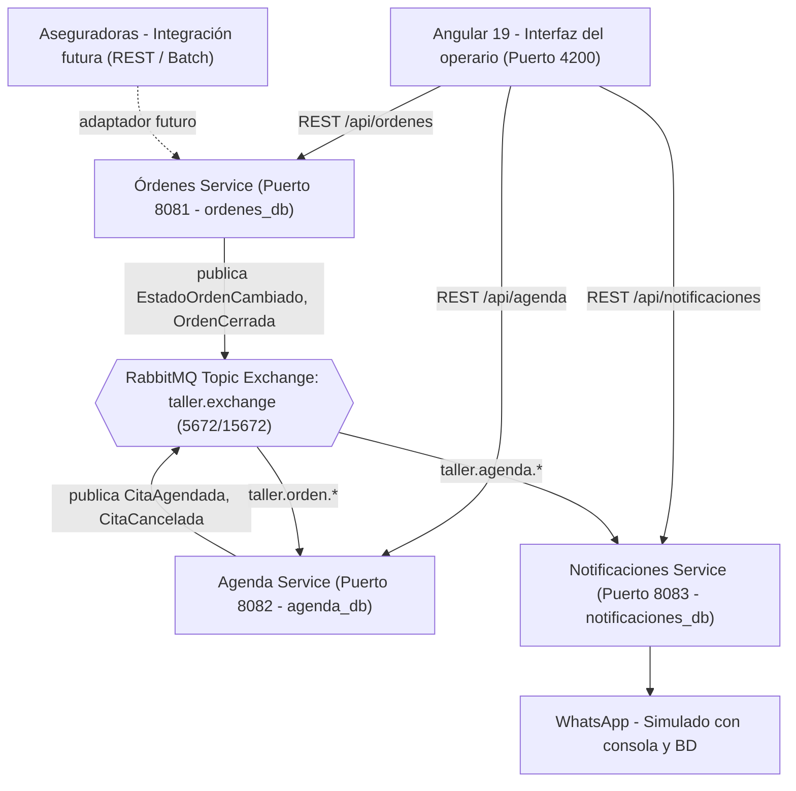

# DECISIONES

Sistema para un taller automotriz que atiende vehículos de particulares y de aseguradoras. Este documento explica las fronteras que tracé, las alternativas que descarté y lo que dejé fuera.

---

## 1. Principio rector

Cada dato tiene un solo dueño y solo el dueño lo modifica. Los demás servicios piden el cambio al dueño o guardan una copia de solo lectura, actualizada por eventos. Ningún servicio escribe en la base de datos de otro ni existen llaves foráneas entre esquemas de diferentes servicios.

## 2. Diagrama de contexto



## 3. Fronteras

### 3.1 Órdenes (`ordenes-service`)

- **Es dueño de:** clientes, vehículos, órdenes, estado, transiciones y el registro inmutable de auditoría.
- **Responsabilidad:** es la única que cambia el estado de una orden. Valida las transiciones (por ejemplo, reabrir exige obligatoriamente una razón no vacía), persiste el cambio y su registro de auditoría en la misma transacción (`@Transactional`), y publica el evento en `taller.exchange`.
- **Por qué aquí:** las transiciones ocurren en Órdenes, así que la auditoría vive donde ocurre el cambio y no hay forma técnica de cambiar un estado sin dejar registro inmediato.

### 3.2 Agenda (`agenda-service`)

- **Es dueño de:** operarios, franjas, cupos y citas.
- **Responsabilidad:** agenda y cancela citas respetando el cupo atómico por operario y franja. Guarda una copia de solo lectura del estado de la orden (`OrdenReplica`), actualizada de forma asíncrona por eventos. La referencia a la orden es un `ordenId` (UUID) sin llave foránea física.
- **No escribe el estado de la orden.** Si necesita cerrar una orden, lo solicita al endpoint de Órdenes.
- **Por qué separada:** el cupo por franja exige consistencia inmediata en base de datos y control estricto de concurrencia, un problema transaccional propio que no debe interferir con el ciclo de vida de la orden.

### 3.3 Notificaciones (`notificaciones-service`)

- **Es dueño de:** las plantillas de mensaje, la política de negocio sobre a quién avisar y el historial persistido de notificaciones emitidas.
- **Responsabilidad:** consume eventos de la cola `taller.notificaciones.citas` y simula el envío por WhatsApp mediante logs formateados en consola y registros en su propia base de datos (`notificaciones_db`).
- **Por qué separada:**
  - Aísla fallos: si el canal de mensajería colapsa o sufre latencia, las órdenes y las citas continúan operando con normalidad.
  - El canal cambia por razones distintas a las del negocio de órdenes (hoy log, mañana WhatsApp Business API, SMS o Email).
  - Es transversal: atiende eventos de cualquier servicio sin acoplarlos a los detalles de entrega.
  - Automatizar los avisos por WhatsApp soluciona el dolor operativo central del taller (previamente manual).

## 4. Comunicación

- **REST síncrono** entre el frontend y los microservicios, donde el usuario necesita retroalimentación visual inmediata (crear órdenes, cambiar estados, consultar citas y cupos).
- **Eventos asíncronos** entre microservicios mediante **RabbitMQ**:
  - **Exchange:** `taller.exchange` (tipo `topic`, durable).
  - **Colas durables:**
    - `taller.agenda.ordenes` (routing keys: `taller.orden.estado-cambiado`, `taller.orden.cerrada`).
    - `taller.notificaciones.citas` (routing keys: `taller.agenda.cita-agendada`, `taller.agenda.cita-cancelada`).
  - **Dead Letter Exchange (DLQ):** configurado con `x-dead-letter-exchange: taller.dlx` para capturar mensajes malformados o fallidos tras reintentos.
  - **Idempotencia:** cada mensaje incluye un `eventId` (UUID). Los microservicios consumidores cuentan con una tabla `processed_events` que garantiza que mensajes duplicados por reentrega de red no generen efectos colaterales dobles.
  - **Garantía transaccional:** se utiliza `@TransactionalEventListener(phase = TransactionPhase.AFTER_COMMIT)` en los publicadores de Spring para asegurar que los eventos solo viajen al broker una vez la transacción de base de datos local haya hecho commit exitoso. Para escenarios de altísima escala se consideró el Transactional Outbox Pattern, el cual queda proyectado como evolución arquitectónica.

| Evento | Emisor | Routing Key | Consumidores | Efecto |
|---|---|---|---|---|
| `EstadoOrdenCambiadoEvent` | Órdenes | `taller.orden.estado-cambiado` | Agenda | Actualiza `OrdenReplica` local con el nuevo estado |
| `OrdenCerradaEvent` | Órdenes | `taller.orden.cerrada` | Agenda | Cancela citas pendientes con motivo `CIERRE_ORDEN` y libera cupos |
| `CitaAgendadaEvent` | Agenda | `taller.agenda.cita-agendada` | Notificaciones | Genera log y registro WhatsApp de confirmación de cita al cliente |
| `CitaCanceladaEvent` | Agenda | `taller.agenda.cita-cancelada` | Notificaciones | Evalúa política: si motivo != `CIERRE_ORDEN`, avisa al cliente; si motivo == `CIERRE_ORDEN`, se omite |

## 5. Decisiones sobre las reglas del enunciado

### 5.1 El cierre cancela citas y no avisa al cliente (RF-18, RF-24)

Agenda consume `OrdenCerradaEvent`, identifica las citas en estado `AGENDADA` asociadas a esa orden, actualiza su estado a `CANCELADA`, libera atómicamente el cupo de la franja y emite `CitaCanceladaEvent` con `motivo: "CIERRE_ORDEN"`.

La política de a quién avisar reside exclusivamente en `notificaciones-service`. El listener verifica:
```java
if ("CIERRE_ORDEN".equalsIgnoreCase(event.getMotivo())) {
    log.info("[WHATSAPP OMITIDO] Cita {} cancelada por CIERRE_ORDEN. Se omite notificación según RF-24.", event.getCitaId());
    return; // No se envía WhatsApp porque el cliente ya retiró el vehículo
}
```
Así Agenda permanece desacoplada de las políticas de comunicación y no tiene que decidir sobre el canal.

### 5.2 Cupo por operario y franja (RF-15, RF-16)

Para evitar condiciones de carrera cuando múltiples operarios o clientes agendan simultáneamente en la misma franja, se descartó el patrón anti-patrón "SELECT COUNT + INSERT". En su lugar, se implementó una actualización atómica a nivel de motor de base de datos con comprobación de condición:

```sql
UPDATE franja_cupo 
SET ocupados = ocupados + 1 
WHERE id = :id AND ocupados < cupo_maximo;
```

Si el número de filas afectadas es `0`, significa que la franja alcanzó su límite (`ocupados >= cupoMaximo`) y se lanza inmediatamente `FranjaSinCupoException` (HTTP 409 Conflict).

- **Prueba de concurrencia:** implementada en `back/agenda-service/src/test/java/com/subocol/agenda/CupoConcurrenteTest.java`. Ejecuta 10 hilos concurrentes compitiendo en paralelo mediante `CountDownLatch` y `ExecutorService` por una franja con cupo máximo de 2. La prueba valida que exactamente 2 citas son aceptadas, 8 son rechazadas con error de cupo, y la base de datos termina con exactamente 2 ocupados.

### 5.3 Estados y reapertura (RF-05, RF-06, RF-07, RF-08)

Órdenes aplica una máquina de estados determinista (`Orden.cambiarEstado(nuevoEstado, razon, usuarioId)`):
- Estados: `RECIBIDA` -> `EN_DIAGNOSTICO` -> `EN_REPARACION` -> `REPARADA` -> `CERRADA`.
- Transiciones directas válidas:
  - `RECIBIDA` -> `EN_DIAGNOSTICO`
  - `EN_DIAGNOSTICO` -> `EN_REPARACION`
  - `EN_REPARACION` -> `REPARADA`
  - `REPARADA` -> `CERRADA`
- Transición de reapertura:
  - `CERRADA` -> `EN_REPARACION` (exige `razon != null && !razon.trim().isEmpty()`). Si no se provee razón, se arroja `ReaperturaSinRazonException` (HTTP 422).
- Cualquier otra transición no autorizada arroja `TransicionInvalidaException` (HTTP 400).
- Cada cambio exitoso registra automáticamente la fila correspondiente en `AuditoriaOrden`.

### 5.4 Auditoría inmutable (RF-09, RF-10)

Para garantizar que nadie pueda alterar el historial de cambios:
1. **Trigger de Base de Datos:** en PostgreSQL se define la función `prevent_audit_modification()` asociada al trigger `trg_prevent_audit_modification` sobre la tabla `auditoria_orden`, bloqueando cualquier instrucción `UPDATE` o `DELETE` con un error `RAISE EXCEPTION`.
2. **Permisos de usuario:** en producción, el usuario `ordenes_user` tiene permisos concedidos únicamente para `SELECT` e `INSERT` sobre dicha tabla (`REVOKE UPDATE, DELETE ON auditoria_orden FROM ordenes_user`).
3. **Encadenamiento criptográfico (Hash Chaining):** cada registro de auditoría almacena un `hash` SHA-256 computado a partir del `hashPrevio` del registro anterior, el `ordenId`, `estadoAnterior`, `estadoNuevo`, `usuarioId`, `razon` y el `timestamp`. Si un usuario con privilegios de administrador de base de datos modifica una fila o suprime un registro histórico, la cadena de hashes queda invalidada, permitiendo auditorías forenses automatizadas.

### 5.5 Órdenes de aseguradoras por integración (RF-11, RF-12)

La entidad `Orden` incluye los campos:
- `origen`: Enum con valores `OPERARIO` o `ASEGURADORA`.
- `idExterno`: Identificador único de siniestro o reclamo asignado por la aseguradora.
- Cuando `origen == ASEGURADORA`, la orden puede originarse automáticamente sin un `usuarioId` de operario asignado inicialmente. Se dejó listo el endpoint `POST /api/ordenes` preparado para recibir estas solicitudes.

---

## 6. Alternativas descartadas

1. **Auditoría como microservicio independiente:** descartado porque agregaría latencia HTTP y fallos de red en cada transición de estado de una orden. Como Órdenes es dueña del estado, la persistencia transaccional ACID (`@Transactional`) garantiza que nunca habrá un cambio de estado sin su registro de auditoría. La seguridad se resuelve con triggers y permisos de solo inserción.
2. **Servicio centralizado de usuarios (Operarios y Clientes):** descartado porque los requerimientos de consistencia y ciclo de vida son completamente divergentes: clientes pertenecen al contexto de Órdenes (con sus vehículos), mientras que operarios pertenecen al contexto de Agenda (requieren consistencia atómica en cupos y franjas horarias).
3. **Llamadas REST síncronas hacia Notificaciones:** descartado porque una indisponibilidad o latencia en el servicio de WhatsApp bloquearía la finalización de citas o el cierre de órdenes en el taller. Con RabbitMQ, el desacoplamiento es absoluto.
4. **Base de datos compartida entre microservicios:** rotundamente descartada. Cada microservicio cuenta con su propia base de datos (`ordenes_db`, `agenda_db`, `notificaciones_db`) y credenciales independientes, evitando acoplamientos a nivel de esquema.

---

## 7. Propuestas de la IA que rechacé

1. **Auditoría como servicio aparte con base propia:** La IA propuso un servicio `auditoria-service` con eventos Kafka. Lo rechacé porque introduce inconsistencia eventual en la auditoría: si el broker falla, el estado de la orden cambia pero la auditoría se pierde. La auditoría debe ser síncrona y transaccional con el cambio de estado.
2. **Sincronización bidireccional completa de entidades entre Órdenes y Agenda:** La IA sugirió replicar las tablas completas de `Cliente` y `Vehiculo` en la base de datos de Agenda mediante Change Data Capture (CDC). Lo rechacé por sobre-ingeniería innecesaria; Agenda solo necesita conocer el `ordenId`, el nombre, teléfono y estado para operar. Se implementó una entidad ligera `OrdenReplica` actualizada mediante eventos puntuales.

---

## 8. Qué dejé fuera y por qué

| Fuera de alcance | Motivo |
|---|---|
| Servidor OAuth2 / JWT real | Se utiliza el header HTTP `X-User-Id` para simular la identidad del operario de manera desacoplada y auditable, suficiente para validar RF-08 y RF-09 sin agregar la sobrecarga de un Identity Provider |
| Conexión con Meta Cloud API (WhatsApp real) | Requiere credenciales empresariales activas, webhooks con dominio público y costos asociados. Se implementó un simulador fiel con logs de consola y persistencia en base de datos para visualización |
| Conector SOAP/REST específico de cada aseguradora | Cada aseguradora maneja protocolos y formatos propietarios. Se implementó el contrato unificado con `origen` e `idExterno` listo para recibir integraciones |
| Módulo de facturación, caja y pasarelas de pago | Excede el alcance del flujo operativo de taller automotriz solicitado en el enunciado |
| Gestión de inventario de repuestos y bodegas | No forma parte de los requerimientos funcionales prioritarios |

---

## 9. Riesgos conocidos y mitigaciones

1. **Ventana de inconsistencia eventual en Agenda:** entre la publicación de `OrdenCerradaEvent` y su consumo por Agenda existe un lapso de milisegundos donde un usuario podría intentar agendar una cita.  
   *Mitigación:* Agenda valida el estado en `OrdenReplica` antes de agendar y, si la cita alcanza a crearse justo antes de recibir el evento, el listener cancela inmediatamente la cita con motivo `CIERRE_ORDEN` y libera el cupo.
2. **Reentrega de mensajes en RabbitMQ (At-least-once delivery):** ante caídas de red o reinicios de contenedor, RabbitMQ puede reenviar mensajes ya consumidos.  
   *Mitigación:* Se implementó la tabla `processed_events` con clave primaria UUID `eventId` en cada microservicio consumidor. Si un evento ya fue procesado, se descarta silenciosamente.
3. **Colisiones de puertos en entornos locales de desarrollo:** PostgreSQL estándar corre en el puerto 5432 y Nginx en el puerto 80 del host.  
   *Mitigación:* En `docker-compose.yml`, PostgreSQL se expone en el puerto de host `5433:5432` y el frontend en `4200:80`.

---

## 10. Cómo ejecutarlo

### Ejecución con un solo comando (Docker Compose)
```bash
docker compose up --build
```

### URLs y Puertos de los servicios
- **Frontend (Angular 19):** `http://localhost:4200`
- **Órdenes Service:** `http://localhost:8081` (Swagger UI: `http://localhost:8081/swagger-ui.html`)
- **Agenda Service:** `http://localhost:8082` (Swagger UI: `http://localhost:8082/swagger-ui.html`)
- **Notificaciones Service:** `http://localhost:8083` (Swagger UI: `http://localhost:8083/swagger-ui.html`)
- **RabbitMQ Management Dashboard:** `http://localhost:15672` (Credenciales: `guest` / `guest`)
- **PostgreSQL Database:** `localhost:5433` (Bases: `ordenes_db`, `agenda_db`, `notificaciones_db`)

### Usuarios de prueba (Simulación con `X-User-Id`)
El frontend incluye un selector rápido de operarios en la barra superior:
- `OP-001` - Carlos Gómez (Mecánico Líder)
- `OP-002` - María Rodríguez (Especialista en Diagnóstico)
- `OP-003` - Andrés Pérez (Recepcionista de Taller)

### Dónde ver los logs de WhatsApp
1. **En la consola de Docker:**
   ```bash
   docker compose logs -f notificaciones-service
   ```
2. **En la interfaz gráfica del Frontend:**
   Navegar a la pestaña **"Simulador WhatsApp"**, la cual consulta en tiempo real `GET /api/notificaciones` y muestra un mockup de smartphone con todos los mensajes emitidos, destacando visualmente la política de omisión cuando una cita se cancela por `CIERRE_ORDEN`.
