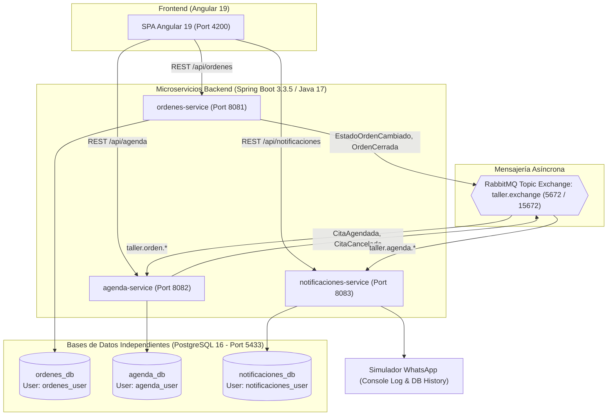

# Sistema de Gestión de Taller Automotriz — Prueba Técnica Subocol

Solución arquitectónica basada en **Microservicios (Spring Boot 3 / Java 17)**, **Frontend Reactivo (Angular 19)**, **Mensajería Asíncrona (RabbitMQ)** y **Bases de Datos Independientes (PostgreSQL)**, diseñada para resolver la operación integral de un taller automotriz que atiende vehículos de particulares y de compañías aseguradoras.

---

## 1. Arquitectura del Sistema

El sistema implementa el principio rector de **Bounded Contexts (DDD)**: *cada dato tiene un solo dueño y solo el dueño lo modifica*. Los microservicios no comparten base de datos, no ejecutan escrituras cruzadas ni existen llaves foráneas entre esquemas de servicios.



### Microservicios y Responsabilidades

| Microservicio | Directorio | Puerto | Base de Datos | Responsabilidad Principal |
|---|---|---|---|---|
| **`ordenes-service`** | `back/ordenes-service` | `8081` | `ordenes_db` | Gestión del ciclo de vida de órdenes de servicio, clientes y vehículos. Máquina de estados determinista, validación de reapertura con razón obligatoria y registro inmutable de auditoría con triggers y hash encadenado. |
| **`agenda-service`** | `back/agenda-service` | `8082` | `agenda_db` | Gestión de operarios, franjas horarias y citas. Control estricto de concurrencia atómica a nivel de BD para evitar sobrecupo. Consumo de eventos para cancelación automática de citas al cerrar órdenes. |
| **`notificaciones-service`** | `back/notificaciones-service` | `8083` | `notificaciones_db` | Consumo de eventos de agendamiento y cancelación. Aplicación de la regla de negocio que **omite el aviso al cliente si la cita se canceló por `CIERRE_ORDEN`** (vehículo ya entregado). Simulación de WhatsApp con persistencia y logs. |
| **`front`** | `front` | `4200` | N/A | Aplicación web en Angular 19 con pipeline Kanban interactivo, visor de auditoría forense, gestor visual de cupos atómicos, simulador WhatsApp en tiempo real y selector de operario (`X-User-Id`). |

---

## 2. Inicio Rápido (Single Command)

### Prerrequisitos
- **Docker Desktop** (con Docker Compose v2+)
- (Opcional para desarrollo local sin Docker): **Java 17 JDK**, **Maven 3.9+**, **Node.js 20+**

### Ejecución en un solo paso
Ejecuta en la raíz del repositorio:

```bash
docker compose up --build
```

Docker descargará las imágenes base, compilará los microservicios Java y la aplicación Angular con builds multi-etapa optimizados, inicializará las tres bases de datos en PostgreSQL con usuarios independientes y configurará las colas y exchanges de RabbitMQ automáticamente.

### URLs y Puertos

- **Interfaz de Usuario (Frontend):** [http://localhost:4200](http://localhost:4200)
- **Documentación Swagger / OpenAPI:**
  - Órdenes Service: [http://localhost:8081/swagger-ui.html](http://localhost:8081/swagger-ui.html)
  - Agenda Service: [http://localhost:8082/swagger-ui.html](http://localhost:8082/swagger-ui.html)
  - Notificaciones Service: [http://localhost:8083/swagger-ui.html](http://localhost:8083/swagger-ui.html)
- **RabbitMQ Management Dashboard:** [http://localhost:15672](http://localhost:15672) (Usuario: `guest` / Clave: `guest`)
- **PostgreSQL (Host):** `localhost:5433` (evita conflicto con el puerto estándar 5432)

---

## 3. Estructura del Repositorio

El proyecto cumple estrictamente la separación en dos carpetas raíz solicitada:

```text
├── back/                             # Backend - Microservicios Java 17 / Maven
│   ├── pom.xml                       # POM Padre (Reactor Maven)
│   ├── ordenes-service/              # Servicio de Órdenes y Auditoría
│   │   ├── Dockerfile
│   │   ├── pom.xml
│   │   └── src/main/java/com/subocol/ordenes/...
│   ├── agenda-service/               # Servicio de Agenda y Cupos Atómicos
│   │   ├── Dockerfile
│   │   ├── pom.xml
│   │   └── src/main/java/com/subocol/agenda/...
│   └── notificaciones-service/       # Servicio de Notificaciones y WhatsApp
│       ├── Dockerfile
│       ├── pom.xml
│       └── src/main/java/com/subocol/notificaciones/...
│
├── front/                            # Frontend - Angular 19 Standalone
│   ├── Dockerfile                    # Multi-stage build (Node build + Nginx Alpine)
│   ├── nginx.conf                    # Configuración de Nginx con reverse proxy /api
│   ├── package.json
│   ├── angular.json
│   └── src/                          # Componentes, modelos y servicios reactivos
│
├── docker/
│   └── postgres-init/
│       └── init-databases.sh         # Script SQL de inicialización multi-database
│
├── docker-compose.yml                # Orquestación de contenedores y redes
├── DECISIONES.md                     # Documento de decisiones de arquitectura
└── REQUISITOS.md                     # Requisitos funcionales y no funcionales
```

---

## 4. Flujo de Negocio y Reglas Clave

### A. Máquina de Estados de Órdenes (RF-05 a RF-08)
El ciclo de vida de una orden sigue una secuencia estricta:
$$\text{RECIBIDA} \longrightarrow \text{EN\_DIAGNOSTICO} \longrightarrow \text{EN\_REPARACION} \longrightarrow \text{REPARADA} \longrightarrow \text{CERRADA}$$

- **Reapertura controlada (RF-07):** Una orden en estado `CERRADA` puede reabrirse exclusivamente al estado `EN_REPARACION`, **exigiendo obligatoriamente una razón no vacía**. Si se intenta reabrir sin razón, el sistema rechaza la solicitud con HTTP 422.
- **Auditoría inmutable (RF-09, RF-10):** Toda transición se almacena en la tabla `auditoria_orden` con usuario responsable, fecha, estados y razón. Un trigger PostgreSQL (`trg_prevent_audit_modification`) bloquea cualquier `UPDATE` o `DELETE`. Adicionalmente, cada registro contiene un **hash SHA-256 encadenado** al registro previo.

### B. Cupo Concurrente y Atómico en Agenda (RF-15, RF-16)
Para garantizar que nunca se sobrepase el cupo por franja horaria ante peticiones simultáneas, la reserva se ejecuta de forma atómica en base de datos:
```sql
UPDATE franja_cupo 
SET ocupados = ocupados + 1 
WHERE id = :id AND ocupados < cupo_maximo;
```
Si la franja está llena (`ocupados >= cupo_maximo`), la sentencia afecta `0` filas y el servicio arroja de inmediato `FranjaSinCupoException` (HTTP 409 Conflict).

### C. Cierre de Orden y Política de WhatsApp (RF-18, RF-24)
Cuando una orden pasa a estado `CERRADA`:
1. `ordenes-service` publica el evento `OrdenCerradaEvent` en `taller.exchange`.
2. `agenda-service` consume el evento, cancela automáticamente todas las citas activas de esa orden con motivo `CIERRE_ORDEN` y libera los cupos de las franjas.
3. `agenda-service` emite `CitaCanceladaEvent(motivo: "CIERRE_ORDEN")`.
4. `notificaciones-service` recibe el evento y aplica la política de negocio: **NO envía notificación por WhatsApp** porque el cliente ya retiró su vehículo del taller. La cancelación queda registrada con bandera informativa sin molestar al usuario.

---

## 5. Pruebas Automatizadas

El proyecto incluye suites de pruebas unitarias, de integración y de concurrencia multihilo en backend.

### Ejecución de pruebas del backend
Para ejecutar las pruebas de todos los microservicios mediante el Reactor de Maven:

```bash
mvn test -f back/pom.xml
```

Resultados de pruebas incluidas:
- **`ordenes-service`:**
  - `OrdenStateMachineTest`: Validación de transiciones válidas, transiciones inválidas y obligatoriedad de razón en reapertura.
  - `AuditoriaHashTest`: Validación de integridad de auditoría y cálculo de hash encadenado SHA-256.
- **`agenda-service`:**
  - `CupoConcurrenteTest`: **Prueba de concurrencia multihilo** usando `ExecutorService` y `CountDownLatch` (10 hilos simultáneos compitiendo por 2 cupos máximos; exactamente 2 citas son aprobadas, 8 son rechazadas con HTTP 409 y la franja queda en 2 ocupados).
  - `OrdenCerradaEventListenerTest`: Verificación de cancelación automática de citas y liberación atómica de cupos al recibir `OrdenCerradaEvent`.
- **`notificaciones-service`:**
  - `NotificacionPolicyTest`: Verificación de envío de mensaje en citas normales y **omisión estricta de WhatsApp** cuando el motivo es `CIERRE_ORDEN` (RF-24).

---

## 6. Guía de Uso del Frontend

La interfaz de usuario fue diseñada para proporcionar una experiencia visual clara, moderna y pedagógica:

1. **Barra de Operario (`X-User-Id`):** Permite cambiar de operario con un clic (`Carlos Gómez`, `María Rodríguez`, `Andrés Pérez`) para simular la autoría en las transiciones de auditoría.
2. **Guía Interactiva de 5 Pasos:** Un banner superior interactivo con botones de salto rápido que explica paso a paso el flujo de negocio del taller.
3. **Pipeline Kanban de Órdenes:**
   - Visualización de tarjetas por columna (`RECIBIDA`, `EN_DIAGNOSTICO`, `EN_REPARACION`, `REPARADA`, `CERRADA`).
   - Botones de acción contextual para avanzar la orden al siguiente estado.
   - Botón especial de **"Reabrir Orden"** en la columna CERRADA que despliega un modal exigiendo el motivo de reapertura.
   - Botón de **"Auditoría"** que despliega el historial completo de transiciones, con fecha, operario y hash de integridad.
4. **Gestión de Agenda y Cupos:**
   - Creación de franjas horarias con cupo máximo configurable.
   - Indicadores de capacidad en tiempo real con barra de progreso y badges (`X / Y Cupos`, `DISPONIBLE`, `LLENA`).
   - Agendamiento de citas asociadas a órdenes activas y operarios.
5. **Simulador de WhatsApp:**
   - Emulador con marco de smartphone que muestra en tiempo real las notificaciones emitidas por el sistema.
   - Mensajes con estilo de chat de WhatsApp (burbujas verdes, hora y doble check).
   - Card explicativo de la política de `CIERRE_ORDEN` para verificar visualmente que el cliente no recibe spam al retirar su vehículo.
6. **Diagrama de Arquitectura:**
   - Pestaña con la arquitectura de microservicios y detalle de contratos.

---

## 7. Contratos de API (cURL de Ejemplo)

### A. Órdenes Service (Puerto 8081)

#### 1. Crear Orden (Cliente Particular)
```bash
curl -X POST http://localhost:8081/api/ordenes \
  -H "Content-Type: application/json" \
  -H "X-User-Id: OP-001" \
  -d '{
    "clienteNombre": "Juan Pérez",
    "clienteDocumento": "1020304050",
    "clienteTelefono": "+573001234567",
    "clienteEmail": "juan@example.com",
    "vehiculoPlaca": "ABC123",
    "vehiculoMarca": "Toyota",
    "vehiculoModelo": "Corolla 2022",
    "descripcion": "Revisión de frenos y cambio de aceite",
    "origen": "OPERARIO"
  }'
```

#### 2. Cambiar Estado de la Orden
```bash
# Reemplazar {ordenId} por el UUID retornado
curl -X PATCH http://localhost:8081/api/ordenes/{ordenId}/estado \
  -H "Content-Type: application/json" \
  -H "X-User-Id: OP-001" \
  -d '{
    "nuevoEstado": "EN_DIAGNOSTICO",
    "razon": "Ingreso a rampa 1 para escaneo"
  }'
```

#### 3. Reabrir Orden Cerrada (Requiere Razón)
```bash
curl -X POST http://localhost:8081/api/ordenes/{ordenId}/reabrir \
  -H "Content-Type: application/json" \
  -H "X-User-Id: OP-001" \
  -d '{
    "razon": "Garantía: cliente reporta ruido persistente en rueda delantera"
  }'
```

#### 4. Consultar Historial de Auditoría
```bash
curl -X GET http://localhost:8081/api/ordenes/{ordenId}/auditoria
```

---

### B. Agenda Service (Puerto 8082)

#### 1. Crear Franja Horaria con Cupo
```bash
curl -X POST http://localhost:8082/api/agenda/franjas \
  -H "Content-Type: application/json" \
  -d '{
    "operarioId": "OP-001",
    "fecha": "2026-11-12",
    "horaInicio": "08:00:00",
    "horaFin": "10:00:00",
    "cupoMaximo": 2
  }'
```

#### 2. Agendar Cita
```bash
curl -X POST http://localhost:8082/api/agenda/citas \
  -H "Content-Type: application/json" \
  -d '{
    "ordenId": "{ordenId}",
    "franjaId": "{franjaId}",
    "motivo": "Diagnóstico inicial de suspensión"
  }'
```

#### 3. Cancelar Cita Manualmente
```bash
curl -X POST http://localhost:8082/api/agenda/citas/{citaId}/cancelar \
  -H "Content-Type: application/json" \
  -d '{
    "motivo": "Cliente solicitó reprogramar"
  }'
```

---

### C. Notificaciones Service (Puerto 8083)

#### 1. Consultar Historial de Notificaciones WhatsApp
```bash
curl -X GET http://localhost:8083/api/notificaciones
```

---

## 8. Verificación de Criterios de Aceptación (REQUISITOS.md)

| ID | Criterio de Aceptación | Estado | Implementación / Evidencia |
|---|---|:---:|---|
| **RF-01** | Registro de clientes con datos de contacto | ✅ | `ordenes-service`: Entidad `Cliente` con nombre, documento, teléfono y correo. |
| **RF-02** | Registro de vehículos asociados al cliente | ✅ | `ordenes-service`: Entidad `Vehiculo` con placa única, marca y modelo. |
| **RF-03** | Creación de orden de servicio en estado inicial `RECIBIDA` | ✅ | `ordenes-service`: `POST /api/ordenes` inicializa la orden en `RECIBIDA`. |
| **RF-04** | Registro del origen de la orden (`OPERARIO` / `ASEGURADORA`) | ✅ | `ordenes-service`: Campo `origen` y `idExterno` soportados en DTO y Entidad. |
| **RF-05** | Máquina de estados determinista | ✅ | Transiciones validadas: `RECIBIDA` -> `EN_DIAGNOSTICO` -> `EN_REPARACION` -> `REPARADA` -> `CERRADA`. |
| **RF-06** | Rechazo de transiciones inválidas | ✅ | Arroja `TransicionInvalidaException` (HTTP 400). Probado en `OrdenStateMachineTest`. |
| **RF-07** | Reapertura exclusiva desde `CERRADA` a `EN_REPARACION` con razón | ✅ | Endpoint `POST /reabrir` exige razón no vacía (HTTP 422 si falta). |
| **RF-08** | Registro de usuario en cada cambio de estado | ✅ | Header `X-User-Id` capturado y persistido en la entidad y auditoría. |
| **RF-09** | Auditoría obligatoria por cada cambio de estado | ✅ | Tabla `auditoria_orden` persiste usuario, fecha, estado anterior, estado nuevo y razón. |
| **RF-10** | Inmutabilidad de registros de auditoría | ✅ | Trigger PostgreSQL bloquea `UPDATE`/`DELETE` + Hash SHA-256 encadenado. |
| **RF-11** | Costura de integración para órdenes de aseguradoras | ✅ | Soporte de `origen=ASEGURADORA` e `idExterno` sin exigir operario inicial. |
| **RF-13** | Registro de operarios y disponibilidad | ✅ | `agenda-service`: Entidad `Operario` y `FranjaCupo` por fecha y horario. |
| **RF-14** | Definición de cupo máximo por franja | ✅ | Atributo `cupoMaximo` por franja horaria. |
| **RF-15** | Control atómico de concurrencia en cupos | ✅ | Sentencia SQL atómica condicional. Probado con 10 hilos en `CupoConcurrenteTest`. |
| **RF-16** | Rechazo de agendamiento si cupo está lleno | ✅ | Arroja `FranjaSinCupoException` (HTTP 409 Conflict). |
| **RF-18** | Cancelación automática de citas al cerrar orden | ✅ | `agenda-service` consume `OrdenCerradaEvent`, cancela citas y libera cupos. |
| **RF-22** | Simulación de WhatsApp con logs | ✅ | `notificaciones-service` formatea y muestra en consola los mensajes de WhatsApp. |
| **RF-24** | Omisión de aviso WhatsApp por `CIERRE_ORDEN` | ✅ | Política en listener: si `motivo == CIERRE_ORDEN`, no genera mensaje (evita spam). |
| **RF-25** | Persistencia de historial de notificaciones | ✅ | Tabla `notificacion` en `notificaciones_db` consultable vía REST. |
| **RF-26** | Idempotencia en consumidores de eventos | ✅ | Tabla `processed_events` por microservicio para evitar duplicación ante reintentos. |
| **RNF-01** | Arquitectura de microservicios estricta | ✅ | Separación de carpetas `back/` y `front/`, 3 microservicios independientes, 3 BDs. |
| **RNF-04** | Despliegue en un solo paso | ✅ | Orquestado con `docker compose up --build`. |

---

## 9. Contacto y Créditos
- **Autor:** Esteban Cifuentes
- **Repositorio:** [https://github.com/Esteban050/prueba_tecnica_subocol.git](https://github.com/Esteban050/prueba_tecnica_subocol.git)
- **Prueba Técnica:** Taller Automotriz Subocol
